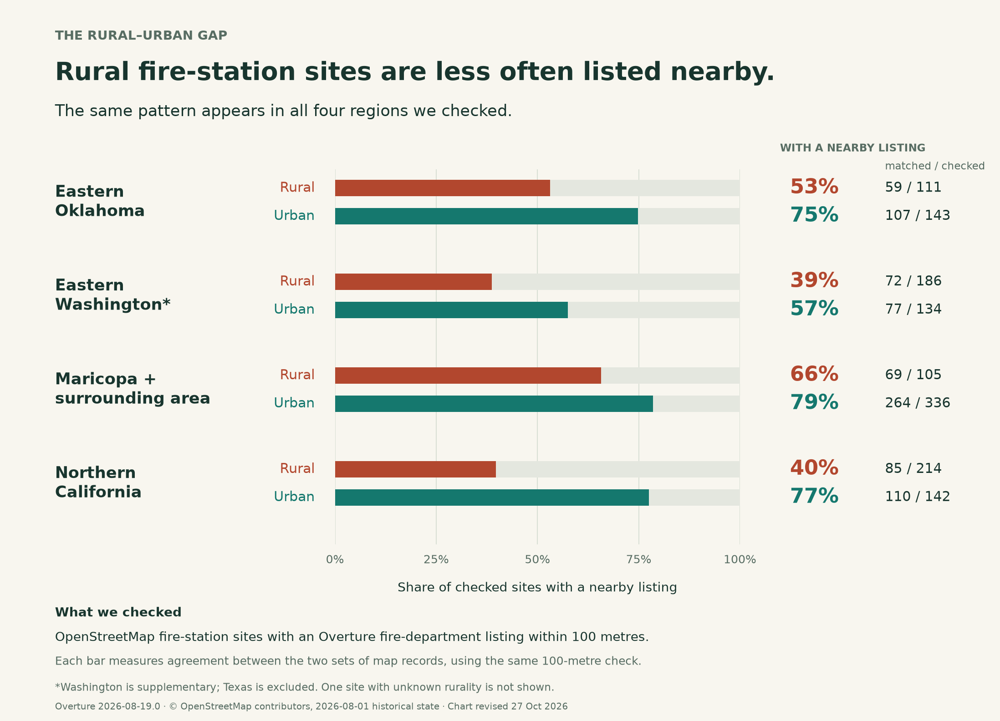
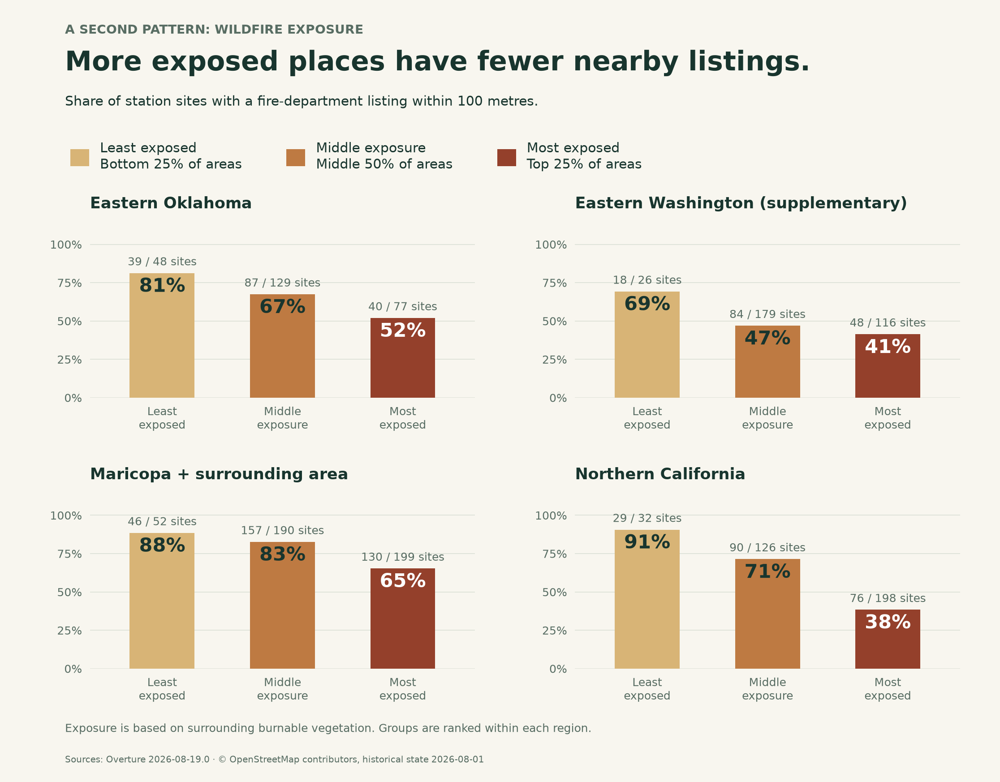
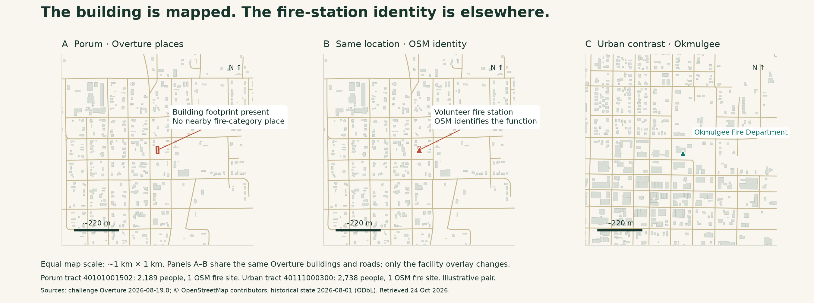
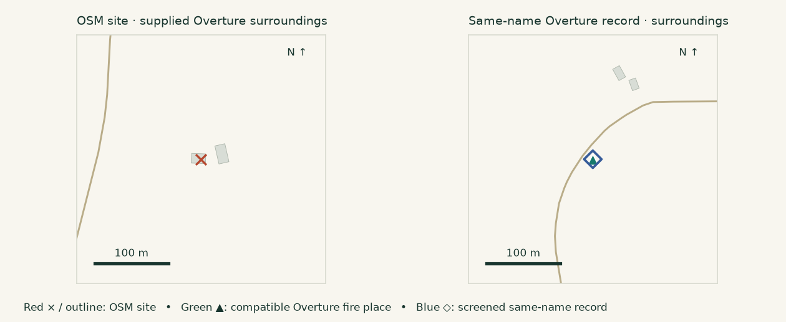

# Imagine You Need Help—but the Map Puts Your Fire Station Miles Away, in Another Town.

**Best Bias Discovery · Israel-Orere · 24 October 2026**

**Reproduce this analysis:** [Download the code and evidence package](zindi_bias_discovery_evidence.zip) · [Run instructions](reproduce_analysis.md)

**Fire-station sites in rural and more wildfire-exposed areas had fewer nearby fire-department listings. Porum and Westport show a concrete problem: the building is mapped locally while the department's listing points elsewhere.**

We follow the rural–urban gap, the wildfire pattern, and the local evidence to show why checking locations matters alongside counting facilities.

## Rural fire-station sites are less often listed nearby

**In every region we checked, rural sites were less likely than urban sites to have a fire-department listing nearby.** In Northern California, about **4 in 10 rural sites** had one, compared with **8 in 10 urban sites**. The gap was smaller in the other regions, but it pointed in the same direction.

We compared **1,372 fire-station sites in OpenStreetMap** with fire-department listings in Overture, the map data supplied for this challenge. We checked whether each site had a listing within 100 metres.

## More wildfire exposure, fewer nearby fire-department listings

**In all four regions, sites in the highest-exposure quarter had fewer nearby listings than sites in the lowest-exposure quarter.** In Northern California, the share fell from **91% to 38%**: 29 of 32 sites in the lowest quarter had a nearby listing, compared with 76 of 198 in the highest quarter. In Maricopa and the surrounding area, it fell from **88% to 65%**.

We ranked census tracts from lower to higher landscape wildfire exposure within each region. The supplied measure describes the surrounding landscape, including proximity to vegetation that can burn.

## The wildfire association persists after accounting for other differences

**The wildfire pattern remained after we took account of differences between communities.** Fire-station sites in more exposed areas were still less likely to have a fire-department listing nearby.

We considered differences such as population, whether an area was rural or urban, and the number of mapped stations. The same pattern appeared when we searched within **50 or 200 metres** of each site, instead of 100 metres.

## The building is mapped locally. The department's listing is elsewhere.

**In Porum and Westport, Overture retains a building at the supported station site but places the department's listing somewhere else.** We checked the locations against published addresses and public records. The results show how a community's emergency resource can remain on the map while becoming harder to find locally.

## Porum: a volunteer department, assigned to another town

Overture lists “Porum Volunteer Fire Department” in Muskogee, **44.4 km from the station site mapped in Porum by OpenStreetMap**. Yet Overture still shows a building at the local site.

A county-published tanker contract from October 2024 gives the department's address as **205 North 2nd Street, Porum, Oklahoma**, on [page 2](https://muskogee.okcounties.org/file/item_8_-_contract_porum_vfd_fire_master_fire_equipment_2427.pdf). Overture gives its listing a Muskogee address instead. The department's name has been assigned to another town.

The rural census tract around the site had **2,189 residents** in 2020. It falls in the **most socially vulnerable quarter of US tracts**, and its landscape wildfire exposure is higher than about **88% of tracts in the supplied region**.

## Westport: a location error that a simple count can miss

**Overture places Westport's fire-department listing 616 metres from the station site supported by local address records.** It still maps the building at that site.

The department's [published address](https://www.westportvfd.org/contact-wvfd) and a [county address point](https://www.arcgis.com/home/item.html?id=8bb2807c2bbe4df58d18910ab3ec1acd) support the station location mapped in OpenStreetMap.

The listing and station site fall in the same census tract. Moving the listing to the station would not change the tract's total. **Counting departments alone can miss misplaced resources.**

## What these results could mean for real-life disaster response

**A misplaced listing could keep a local department out of a relief team's resource list or give a visiting crew the wrong meeting point.**

Imagine a relief coordinator building a local emergency-resource list from these place coordinates. A five-kilometre-radius search covering the local station would exclude Porum's same-name record. The department could disappear from that local list while remaining visible in another town's results.

In Westport, a visiting support crew using the listing as a meeting point could receive coordinates 616 metres from the supported station location. Someone checking only the tract's total could miss the problem.

## The way forward: bridging the mapping gap

**Emergency-resource maps need to show where help is, as well as how much is counted.** Check fire-department listings against local addresses and station sites. Flag records assigned to the wrong town, and check that the department's listing aligns with its station building.

Prioritise location checks in rural and wildfire-exposed areas. **A map should help people find the help a community already has.**

*We measured how fire-station sites appear in the map data, not whether communities have fire service. The disaster-response examples describe possible consequences, not documented incidents. Full details are in the [analysis notes](article_analysis_notes.md).*

*Evidence: Overture 2026-08-19.0; OSM historical state 2026-08-01. Four complete regions, including supplementary Eastern Washington; Texas excluded. Sources checked 24 October 2026; article revised 31 October. Full sources and methods: [case audit](comprehensive_case_audit.md), [equity analysis](equity_followup_report.md) and [methodology](methodology.md).*
