# Full case review: where the fire-station identity belongs

Reviewed 24 October 2026. All 11 exact-name separations above 500 m in the four completed regions were reviewed: 3 supported location errors, 5 distinct-facility pairings, 3 unresolved. The ten original cases plus one Arizona case are included. These are selected candidates, not a random sample or an error-rate estimate.

## 1. Porum Volunteer Fire Department

**Supported: wrong town** — Rural · eastern-ok · 44.443 km point separation · different tracts

The county's signed 2024 apparatus contract identifies the department at 205 North 2nd Street in Porum, postcode 74455. Overture assigns the same street number and department name to Muskogee, postcode 74401-6635, about 44.4 km away. Its supplied building layer retains the OSM station building in Porum; no compatible fire place lies within 200 m of that site.

A coordinate–locality conflict is supported. Confusion between the same street address in different towns is a plausible mechanism, but the source-processing step has not been established. The other endpoint also intersects a building, so footprint overlap alone would not detect this error.

Evidence strength: Strong locality evidence; precise operational entrance not surveyed.

Next step: Confirm the exact current entrance with the department before proposing a replacement coordinate. Use this case in the discovery narrative.

Local compatible fire places: None within the 350 m context search.

OSM way/524779554; Overture b8dbd5fb-9deb-4e96-92ee-918971bdbeb5; confidence 0.8428; root source meta.

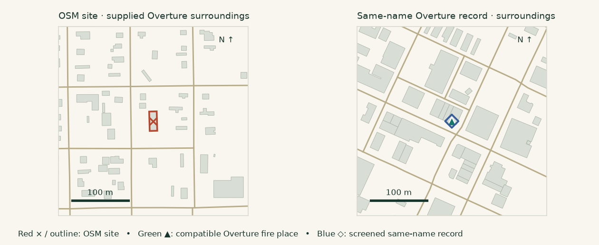

- [Muskogee County: Porum apparatus contract, page 2, signed 21 October 2024](https://muskogee.okcounties.org/file/item_8_-_contract_porum_vfd_fire_master_fire_equipment_2427.pdf) — Downloaded and visually read pages 1–2; scanned PDF has no extractable text
- [Muskogee County: fire departments](https://muskogee.okcounties.org/offices/fire-departments) — Archived official HTML

## 2. Broken Arrow Fire Station #3

**Supported: stale station location** — Urban · eastern-ok · 3.886 km point separation · different tracts

OSM places Station 3 at 5420 South 23rd Street. Overture's same-name record lists 8000 South Elm Place, 3.9 km away. The city-authored 2021 annual report says the new Station 3 opened on 23rd Street in August 2021; the current city facility directory also lists 5420 South 23rd. The new site's building is present in Overture but no fire-category place lies within 200 m.

The coordinate and address are inconsistent with the replacement station that opened roughly five years before this snapshot. The city's 2021 news archive describes replacement of the older Station 3 on South Elm Place. This urban case shows that stale location records are not confined to rural communities.

Evidence strength: Strong official address and relocation evidence.

Next step: Use as a supported recurrence example, distinguishing a stale relocation from Porum's wrong-town assignment.

Local compatible fire places: None within the 350 m context search.

OSM way/1273496281; Overture f50fb6a8-909a-475c-a8fa-6ee1827c309e; confidence 0.7176; root source meta.

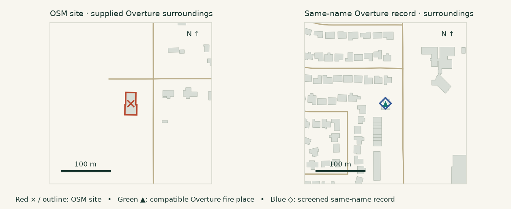

- [City of Broken Arrow: Station 3 facility directory](https://www.brokenarrowok.gov/Home/Components/FacilityDirectory/FacilityDirectory/24/1154) — Official search-index text; direct request returned 403
- [City-authored 2021 Fire Department Annual Report, pages 4 and 7](https://fliphtml5.com/jfvjw/lvcx/2021_Broken_Arrow_Fire_Department_Annual_Report/) — Indexed city-authored publication; identifies address and August 2021 opening
- [City of Broken Arrow news archive: 9 August 2021 station opening](https://www.brokenarrowok.gov/i-want-to/advanced-components/list-detail-pages/news-list/-utm_medium-email/-utm_source-govdelivery/-arch-1/-npage-23) — Official indexed news archive describes replacement of South Elm station

## 3. Westport Volunteer Fire Department

**Supported: address–coordinate offset** — Rural · northern-ca · 0.616 km point separation · same tract

The department publishes 37551 Shoreline Highway. Mendocino County Planning and Building Services' public address layer places 37551 North Highway 1 at (-123.7827827, 39.6417826), about 0.7 m from the OSM point. Overture carries the matching address but its fire place is approximately 616 m north. The local site is inside a supplied Overture building; the distant place is outside supplied footprints.

The published address and county address point corroborate the OSM site, supporting a misplaced fire-place coordinate. The county explicitly describes its address layer as a working layer containing errors and requiring verification; this is strong desktop corroboration, not a field survey. The 2026 county layer update predates the Overture snapshot.

Evidence strength: Corroborated by department address and county working address layer.

Next step: Retain as supported recurrence with the county-layer caveat. Seek department confirmation before publishing a replacement coordinate as authoritative.

Local compatible fire places: None within the 350 m context search.

OSM node/7717447935; Overture b8d23c58-82d2-444f-864b-4a0e894d51b3; confidence 0.7838; root source meta.

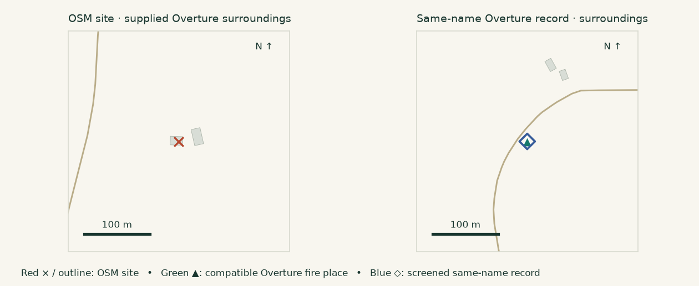

- [Westport Volunteer Fire Department: contact and physical address](https://www.westportvfd.org/contact-wvfd) — Official department page archived
- [Mendocino Planning and Building Services: Address Points metadata](https://www.arcgis.com/home/item.html?id=8bb2807c2bbe4df58d18910ab3ec1acd) — Owner MendoPBS.GIS; item modified 21 May 2026; working-layer warning retained
- [County address service: single-address verification query](https://services8.arcgis.com/vVsGmpWOxUEQGPFl/arcgis/rest/services/Address_Points_033021/FeatureServer/0/query?where=SITUS_NUMB%3D%2737551%27&outFields=SITUS_ALL%2CCOMMUNITY&outSR=4326&f=pjson) — Single public address record queried; no countywide reference dataset created

## 4. Yakima County Fire District #5

**Different entities: district office and branch** — Rural · eastern-wa · 21.871 km point separation · different tracts

The 21.9 km exact-name pair compares the district's office at 720 First Avenue in Zillah with its Harrah branch. The district lists Station 3 at 4111 Harrah Road and describes a network of 15 stations. Both endpoints overlap supplied Overture buildings. No compatible Overture fire place was found within 200 m of the OSM Harrah site.

The distance does not show a single station shifted 21.9 km. A district-wide label has been attached to a branch in OSM. The local branch's lack of a nearby fire-category place is a separate, credible coverage lead; the district office should not be moved to Harrah.

Evidence strength: Official district and branch addresses distinguish the entities.

Next step: Review branch-level coverage against the official station list and verify exact branch geometry before claiming a confirmed branch omission.

Local compatible fire places: None within the 350 m context search.

OSM node/3838469709; Overture 8b034e03-93f6-44db-84ea-2c2684f6d985; confidence 0.9071; root source meta.

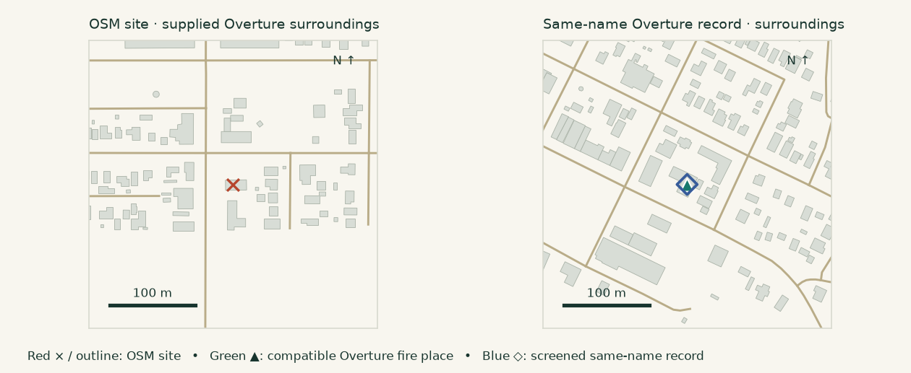

- [Yakima County Fire District 5: district office and station network](https://www.ycfd5.org/) — Official district HTML archived
- [Yakima County Fire District 5: Station 3, Harrah](https://www.ycfd5.org/station3harrah) — Official branch address verified

## 5. Shingletown Volunteer Fire Department

**Different entities: main station and branch** — Rural · northern-ca · 6.364 km point separation · same tract

Overture's record uses 31990 Highway 44, the department's main-site address. The OSM building is about 6.4 km away in Starlight Pines. The department explicitly describes three stations: Alward Way, Bambi and Starlight Pines. The OSM branch building survives in supplied Overture footprints, but no compatible fire place lies within 200 m of it.

This is not evidence that the main-station point belongs at the branch. It is a potential missing branch identity that must be evaluated separately from coordinate accuracy. The official department page establishes multiple stations, but does not by itself pinpoint the Starlight Pines building.

Evidence strength: Official three-station structure established; branch coordinate remains a lead.

Next step: Obtain a dated official branch address or site plan to verify the Starlight Pines geometry and operational status at the snapshot.

Local compatible fire places: None within the 350 m context search.

OSM way/788070385; Overture 1f37c444-b192-47f2-b8b4-6681c0eaa133; confidence 0.9199; root source meta.

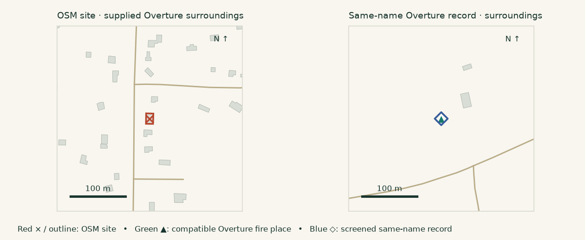

- [Shingletown Volunteer Fire Department: main contact address](https://www.svfd20.org/) — Official department page
- [Shingletown Volunteer Fire Department: three-station description](https://www.svfd20.org/about-co.-20.html) — Official department page explicitly identifies the three branches

## 6. Redding Fire Department

**False pairing: local station already retained** — Urban · northern-ca · 3.033 km point separation · different tracts

The exact-name match pairs OSM Station 2 at 3491 Placer Street with the department's administrative address, 777 Cypress Avenue, about 3.0 km away. Overture separately maps Redding Fire Hall about 6 m from the OSM station, with a compatible fire category. The local building is also present.

Exclude this from location-error and omission counts. The exact-name heuristic overlooked a differently named record that already represents the station. OSM's ref=2 tag and name history help identify the branch.

Evidence strength: Supplied record and official station/admin addresses agree.

Next step: No location-error claim. Keep as a documented negative control for entity matching.

Local compatible fire places: Redding Fire Hall (5.6 m from OSM geometry).

OSM way/515716997; Overture b67f4fd9-3659-43e3-965c-71847cd1e6cb; confidence 0.9199; root source Foursquare.

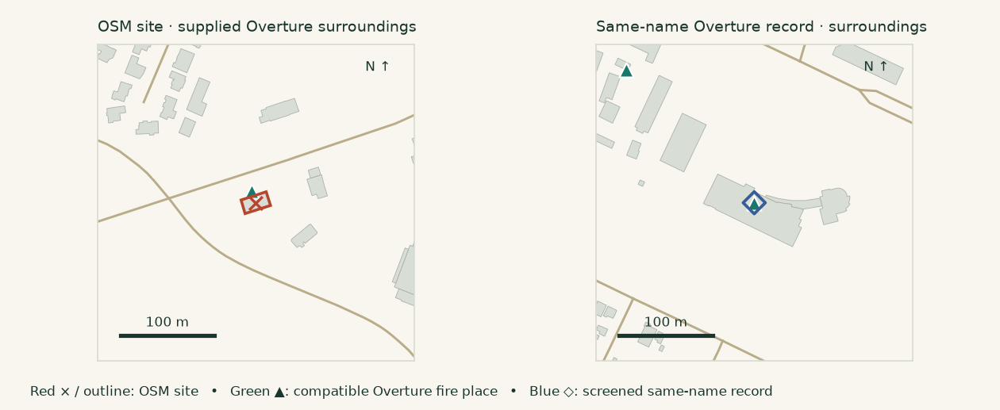

- [City of Redding: fire department contact](https://files.cityofredding.gov/government/departments/fire_department/contact_us.php) — Official HTML archived; administrative address
- [City of Redding: Community Wildfire Protection Plan](https://files.cityofredding.gov/Document%20Center/Departments/Fire/FINAL_Redding_CWPP.pdf) — Official indexed plan lists Station 2 at 3491 Placer Street

## 7. Foresthill Fire Station

**False pairing: separate stations; local site retained** — Rural · northern-ca · 7.621 km point separation · same tract

The OSM site corresponds to CAL FIRE/Placer County Station 11 at 25150 Foresthill Road. The same-name Overture candidate at 20540 Foresthill Road is Foresthill Fire Protection District Station 90, 7.6 km away. Overture already retains Cal Fire Foresthill Station at the OSM site, with a compatible fire category.

Two legitimate facilities share a broad place name. Exclude this from location-error and omission counts. The local site's multiple footprint intersections do not establish that the distant record is misplaced.

Evidence strength: Official county/district station addresses and supplied local record.

Next step: No location-error claim. Preserve station numbers and operators in future entity matching.

Local compatible fire places: Cal Fire Foresthill Station (0.0 m from OSM geometry).

OSM way/1374824410; Overture ae7e28c3-f245-4ed4-8c64-9bd2bf03e126; confidence 0.8619; root source meta.

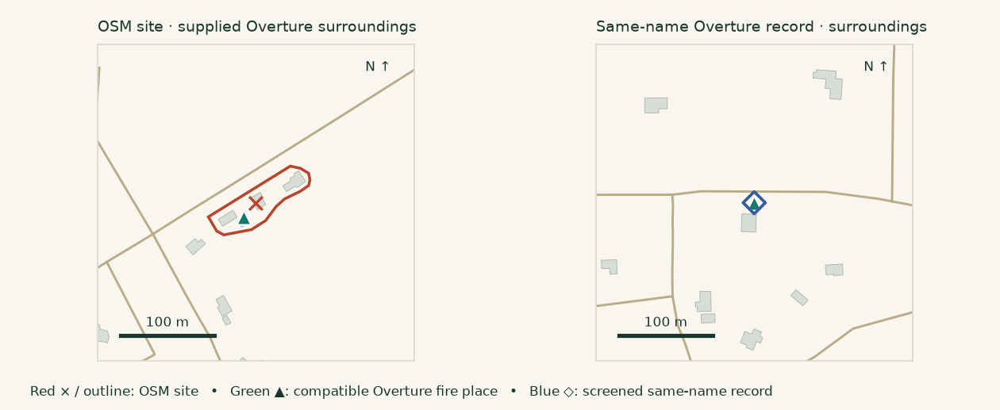

- [Placer County: Foresthill Station 11](https://www.placer.ca.gov/7858/Foresthill-Station-11) — Official indexed address; direct county request returned 403
- [Foresthill Fire Protection District: station locations](https://www.foresthillfire.org/station-locations) — Official HTML archived; Station 90 at 20540 Foresthill Road

## 8. Mesa Fire & Medical Department

**False pairing: Stations 211 and 209** — Urban · maricopa-az · 14.208 km point separation · different tracts

The OSM object has ref=211 and address 2130 North Horne. The exact-name Overture candidate lists 7035 East Southern Avenue, 14.2 km away. The city's station map identifies those addresses as Stations 211 and 209 respectively. Overture separately retains Mesa Fire Station 211 at the OSM site with a compatible fire category.

This newly surfaced Arizona case is a name-based false alarm. Neither the long separation nor the generic department name establishes misplacement; the local station is already present.

Evidence strength: Official station map and supplied local record distinguish both stations.

Next step: Exclude from error and omission counts; keep as an additional entity-matching negative control.

Local compatible fire places: Mesa Fire Station 211 (0.3 m from OSM geometry).

OSM way/151284003; Overture da16dfdd-e630-4a3d-a559-3a82fe8c4a2c; confidence 0.9823; root source meta.

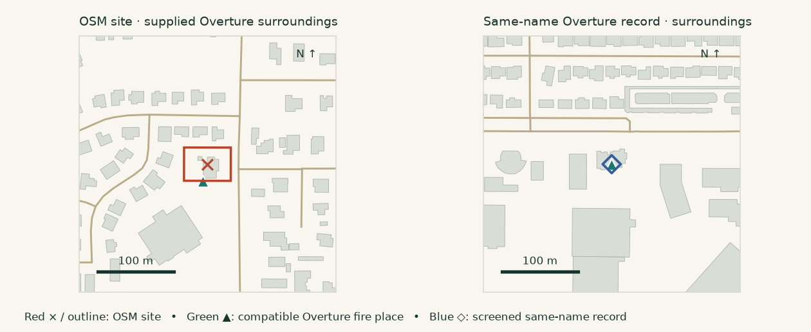

- [City of Mesa: existing fire stations map, revised 6 February 2023](https://www.mesaaz.gov/files/assets/public/v/1/publicsafety/fire/stationmap.pdf) — Official indexed PDF lists Stations 209 and 211 and their distinct addresses

## 9. Eufaula Fire Department

**Unresolved: old address, administration and new station** — Rural · eastern-ok · 0.578 km point separation · same tract

The paired points are about 578 m apart and both use 64 Memorial Drive. The city's contact page labels that address City Hall. A September 2019 council agenda discusses the future of 64 Memorial Drive and Fire Station 1. The fire page identifies a new station project at 1712 JM Bailey Highway; the February 2025 agenda records functional bays/electrics, while April 2026 planning still includes interior work.

A distance discrepancy exists, but neither point is established as the operating station at the August 2026 cutoff. An administrative contact address, old station mapping and staged construction can all explain the records. Do not count it as a confirmed Overture error or an operating OSM station omission.

Evidence strength: Conflicting site roles and incomplete relocation chronology.

Next step: Find a dated opening/relocation record and an authoritative address point for the operating station. Clarify whether both older points are stale.

Local compatible fire places: None within the 350 m context search.

OSM node/7117591984; Overture 78b04e0a-cfcd-4ddb-a01d-34405fee4c1a; confidence 0.9304; root source meta.

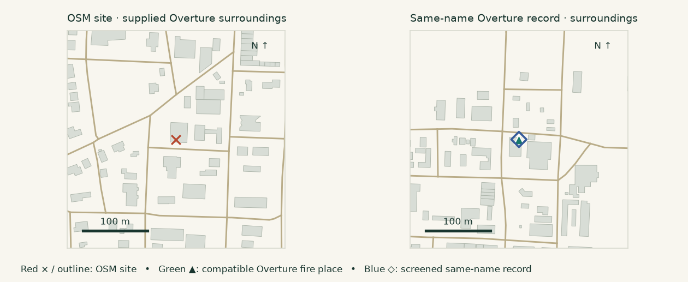

- [City of Eufaula: contact and City Hall address](https://www.cityofeufaulaok.com/contact-us/) — Official page inspected
- [City of Eufaula: fire and new station project](https://www.cityofeufaulaok.com/departments/fire/) — Archived official page; last displayed update 5 December 2025
- [Eufaula council agenda, 3 September 2019](https://www.cityofeufaulaok.com/wp-content/uploads/2019/08/Agenda-Book-9.3.19.pdf) — Official indexed agenda
- [Eufaula council agenda, 3 February 2025](https://www.cityofeufaulaok.com/wp-content/uploads/2025/10/2.3.25_Agenda_Packet.pdf) — Official indexed construction progress
- [Eufaula council agenda, 6 April 2026](https://www.cityofeufaulaok.com/wp-content/uploads/2026/04/Agenda-Book-04.06.26.pdf) — Official indexed interior-work planning

## 10. Webbers Falls Volunteer Fire Department

**Unresolved: current address versus older OSM geometry** — Rural · eastern-ok · 1.030 km point separation · same tract

The town lists the department at 220 North Highway 100, matching Overture's address. The two map sites are about 1.0 km apart. OSM's way dates to 2013 and has not been revised; its representative point is outside the two supplied footprints intersected by the polygon. Overture's endpoint lies inside a supplied building. No compatible fire place lies within 200 m of the OSM geometry.

The published address supports Overture's text, but is insufficient to validate its exact point. The unchanged old OSM geometry and site history also prevent treating OSM as ground truth. This is not a confirmed recurrence of Porum's error.

Evidence strength: Official address established; address-to-building coordinate unresolved.

Next step: Locate an authoritative address point or dated station site plan and resolve any rebuilding/relocation history. Do not propose moving the Overture point based on name similarity alone.

Local compatible fire places: None within the 350 m context search.

OSM way/210884215; Overture 28e96c4a-fec6-4715-baef-e40708362cfd; confidence 0.9736; root source meta.

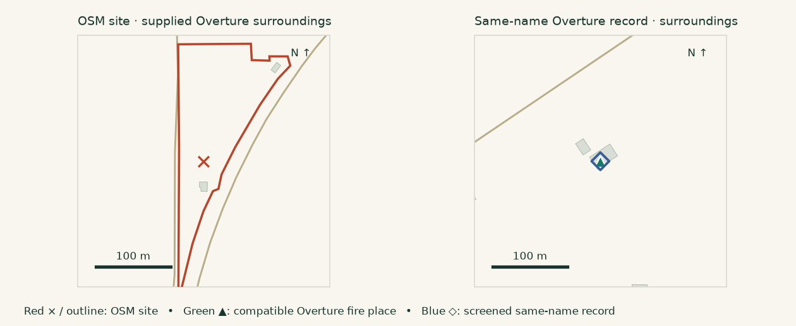

- [Town of Webbers Falls: fire department address](https://webbersfallsok.com/fire-dept/) — Official HTML archived
- [Oklahoma CLEET: Webbers Falls training location, September 2026](https://oklahoma.gov/cleet/training/cleet-training/2024-se-region-classroom-courses/webbers-falls-/tactical-patrol-officer.html) — Official indexed training location; post-snapshot context, not proof of August operating geometry

## 11. Washington County Fire Department

**Unresolved: likely move or agency-contact difference** — Urban · eastern-ok · 2.900 km point separation · different tracts

OSM lists 3931 Southeast Adams Road. The county's older wildfire plan documents that address for the civil-defense fire department. Overture instead uses 1205 Southeast Bison, 2.9 km away, which matches the emergency-management agency's current official contact address. Bartlesville's May 2023 council packet records construction of a new county emergency-management complex on Bison Road.

A credible relocation or shared agency-contact explanation exists. The older Adams address cannot invalidate the current Bison address, and neither the exact move date nor continued operation of the old fire site has been established. Overture's category is central_government_office, rather than the compatible fire_department category.

Evidence strength: Both addresses are documented at different dates.

Next step: Establish which building housed operational fire apparatus on 1 August 2026 and whether the record intentionally represents administration. Do not count this as a confirmed location error.

Local compatible fire places: Washington County Emergency Management (0.0 m from OSM geometry).

OSM way/1246184931; Overture 830d1b68-0fb3-4ca1-b6be-07518019f293; confidence 0.9818; root source meta.

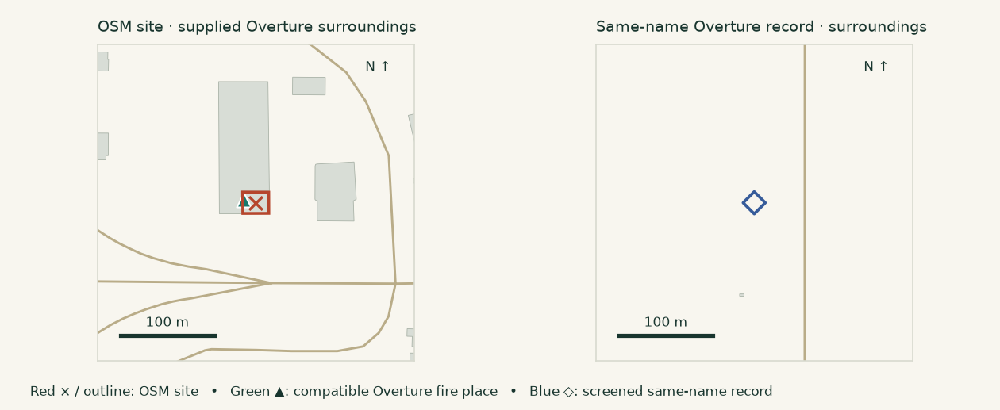

- [Washington County Emergency Management: fire department](https://www.wcema-ok.gov/wcfd) — Official HTML archived; current Bison contact address
- [Washington County Community Wildfire Protection Plan, page 7](https://drive.google.com/file/d/1WhswMNFus-0fagbeWvByXOwbOxuBGbcd/view) — Public county-linked PDF fetched through Google Drive; older Adams address
- [City of Bartlesville council packet, 1 May 2023](https://www.cityofbartlesville.org/wp-content/uploads/2023/04/City-Council-Packet-May-1-2023.pdf) — Official indexed county EOC development record
