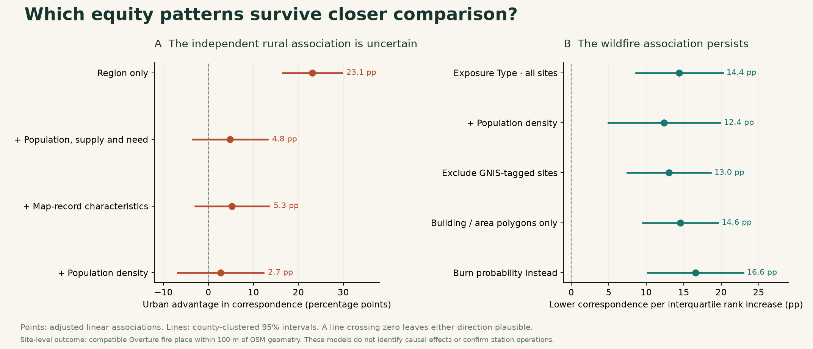
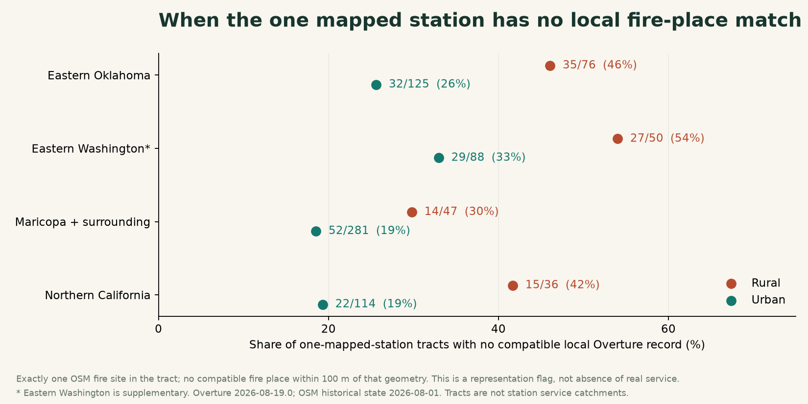
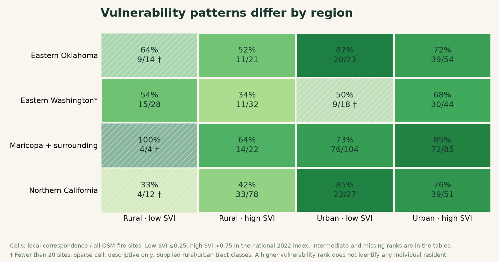

Best Bias Discovery · equity follow-up · 24 October 2026

# Where reliable representation is most needed.

The location cases identify real mapping problems. Equity asks a further question: which communities carry the burden, relative to their needs? This follow-up finds a persistent association with wildfire exposure, while weakening the claim of a separate rural penalty. Social vulnerability and tribal-area overlap do not show a consistent additional penalty across all regions.

1,372 OSM fire sites

1,034 tracts with mapped sites

4 complete regions

120 counties represented

[Short discovery report](bias_discovery_visual_report.md) · [11-case evidence review](comprehensive_case_audit.md) · [Analysis details](equity_analysis_results.json)

## What changed when we tested equity directly

The rural/urban correspondence gaps remain in each region under simpler checks: removing legacy GNIS-tagged records, using only polygon geometries, limiting records to those edited since 2020 or 2023, and removing all eleven reviewed case flags. The pattern extends beyond three illustrative errors. A recent map edit, however, does not prove a station was checked or is operating.

The region-adjusted rural shortfall is 23.1 percentage points. With population, mapped fire-site supply, social vulnerability, wildfire exposure, heat and drought included, it falls to 4.8 points (95% county-clustered interval: a 3.6-point rural advantage to a 13.1-point shortfall). Adding map-record characteristics gives a 5.3-point shortfall; adding population density gives 2.7 points. Both intervals also include zero. These adjustments describe associations; they do not establish causes.

Wildfire exposure has a more persistent association. After those community and map-record adjustments, moving from the 25th to the 75th percentile of exposure within a region is associated with 14.4 percentage points lower correspondence (95% interval: 8.6–20.2 points lower). The estimate stays negative after including density, removing GNIS records, using polygons alone, and changing the radius to 50 or 200 m. Replacing Exposure Type with burn-probability rank gives a 16.6-point shortfall. These measures are distinct and are reported separately.

The exposure association is clearest in Northern California and Maricopa; Eastern Oklahoma's region-specific interval includes zero. Exposure Type is a landscape average of proximity to burnable vegetation, not annual burn probability, personal exposure, housing-weighted exposure or current fire danger. It overlaps conceptually with rurality. Adjusting for it can help explain where the rural disparity occurs; it does not make unequal representation in exposed places unimportant.

## A community-level consequence to investigate

Among tracts containing exactly one OSM-mapped fire site, that site lacks a compatible local Overture place in 91 of 209 rural tracts (43.5%), compared with 135 of 608 urban tracts (22.2%). The rural share is higher in each completed region. A map-based search could therefore fail to find the one mapped fire-service identity in a tract.

This is a representation flag among observed map records. It is not proof that the tract has only one real station, that any station is absent, or that residents lack service. Urban tracts have more unmatched one-site tracts in absolute numbers. The rural flagged tracts contain 289,059 residents in the supplied 2020 data; the urban flagged tracts contain 606,850. These are contextual tract populations, not station catchments or counts of people harmed.

## Who is affected in the verified examples?

| Case | Tract | 2020 population | National SVI rank | Regional exposure percentile | Local correspondence | Evidence |
| --- | --- | --- | --- | --- | --- | --- |
| Porum Volunteer Fire Department | 40101001502 | 2,189 | 0.7735 | 88% | 0/1 OSM sites matched | Supported location error |
| Westport Volunteer Fire Department | 06045010200 | 4,267 | 0.8207 | 95% | 1/5 OSM sites matched | Supported location error |
| Broken Arrow Fire Station #3 | 40143007535 | 2,609 | 0.2808 | 62% | 0/1 OSM sites matched | Supported location error |
| Yakima County Fire District #5 | 53077940001 | 6,540 | 0.9308 | 56% | 0/1 OSM sites matched | Branch coverage lead; not a displaced headquarters |

Porum lies in a rural tract with SVI 0.7735—above the national 75th percentile—and exposure above about 88% of tracts in its supplied region. Its one OSM-mapped fire site's building is present in Overture, while the department record is 44.4 km away in another town. Westport lies in a tract with SVI 0.8207 and exposure near the regional 95th percentile. The supported 616 m offset occurs within the same tract, so an aggregate tract count can retain the facility while losing its local position. Westport's tract contains five OSM fire sites, one locally matched; the other unmatched sites are not all verified omissions.

Broken Arrow remains a supported urban relocation error, in a tract with intermediate SVI. It is a useful counterexample to an exclusively rural story. The Harrah branch of Yakima County Fire District 5 is in a tract with SVI 0.9308 and full overlap with the supplied Yakama Nation Reservation polygon. The district's official page identifies Station 3 at 4111 Harrah Road; the apparent 21.9 km displacement instead compares this branch with the district office. The missing local branch identity is a separate equity lead. We have not independently confirmed the exact operating branch geometry at the snapshot.

Porum's supplied tract intersects Cherokee OTSA statistical geography. This does not identify every resident as Indigenous or establish present legal reservation boundaries. Westport's very small tribal-area intersection—about 0.1% of tract area—likewise cannot support a claim about the whole tract's population.

## What the vulnerability comparisons do—and do not—show

Across all regions, high-SVI rural sites have 45.1% correspondence and low-SVI rural sites 55.2%, but the regional pattern is inconsistent: Northern California reverses that ordering, and some low-SVI cells are very small. High-SVI urban sites have 76.9% correspondence, versus 74.4% for low-SVI urban sites. The overall SVI coefficient is also uncertain after adjustment. We cannot claim a general poverty or social-vulnerability penalty from this evidence.

The planned three-way intersection—rural, high SVI and high regional wildfire exposure—contains 107 sites across 62 tracts, with 47/107 locally matched (43.9%). Its urban counterpart contains 27 sites across 21 tracts, with 20/27 matched (74.1%). These selected groups differ in region, density and other characteristics; every region-specific cell is disclosed in the subgroup table and many are sparse. This is an exploratory concentration of concern, not an identified independent interaction effect.

Substantial tribal-area overlap also does not show a consistent extra deficit: pooled rural sites in tracts with at least 50% overlap have 50.9% correspondence, compared with 43.5% in tracts with no overlap. That pooled contrast mixes geography and regions. Legal-area-only cells are tiny, and Oklahoma statistical areas dominate the broader overlap group. No general claim of anti-tribal undercoverage is supported by this analysis.

## Comparable communities: useful, but overlap is limited

We matched rural and urban tracts within a region and with the same number of OSM fire sites. Population had to be within a factor of 1.3; SVI and regional wildfire-exposure percentiles within 0.20. Selection used no match outcomes. This produced 166 pairs from 356 eligible rural tracts. Correspondence averaged 60.4% in the rural tracts and 68.8% in their urban matches: an 8.3-point gap. A rural-county bootstrap interval spans −2.2 to +18.8 points.

| Region | Matched pairs | Urban minus rural |
| --- | --- | --- |
| All matched regions | 166 | +8.3 pp |
| Eastern Oklahoma | 49 | +20.4 pp |
| Eastern Washington* | 35 | +13.8 pp |
| Maricopa + surrounding | 50 | +0.0 pp |
| Northern California | 32 | -3.1 pp |

The initial matching balances population and SVI well, but exposure remains imbalanced (standardized mean difference 0.45) and polygon representation also differs. We therefore tightened the covariates in an explicitly exploratory follow-up. A 0.10 SVI / 0.10 exposure caliper leaves 97 pairs and a 7.7-point gap. A 0.10 SVI / 0.05 exposure caliper leaves 62 pairs and a 5.6-point gap, with the recorded covariate differences below 0.1 standardized units. Only 17% of eligible rural tracts remain in that strict comparison. Northern California reverses direction in the matched subsets; Maricopa has no gap in the initial set. A universal independent rural disadvantage is not established.

## The equity claim the evidence can currently carry

Local fire-service identities are represented less consistently in wildfire-exposed places. In some socially vulnerable rural communities, the supplied map retains the station building while disconnecting or omitting the local service identity. That can conceal a representation problem behind plausible aggregate counts.

This combines a broader conditional association with verified examples and a clear question about whose emergency resources are locally discoverable. The automated scorecard already compares rurality, vulnerability and hazards; those broad strata alone are not the novel contribution. The contribution to develop is local identity and location consistency within those strata, including the loss of a tract's one mapped station identity and within-tract displacement.

For a submission-ready claim about unequal error rates, the next priority is a balanced operational audit of matched/high-exposure sites: sample unmatched and matched records with known selection probabilities, verify station identities and snapshot-time operation, and compare confirmed error rates. All three supported coordinate cases were selected by a name screen, not randomly sampled. They cannot estimate the prevalence of verified errors in any community group. Consequences for search, preparedness or relief remain plausible mechanisms; dispatch use, travel-time burdens and harm have not been observed here.

## Method, exclusions and reproducibility

The outcome is a compatible primary or alternate fire_department place within 100 m of OSM geometry. OSM is an incomplete, potentially stale comparator. A nearby compatible category does not certify the same entity. There is no confidence cutoff. This analysis covers the 1,372 observed fire sites in 1,034 tracts out of 3,791 supplied tracts across four complete regions. Tracts with no OSM fire site have no reference station to compare; they are not classified as fully covered or service deserts. One site has unknown rurality; fourteen lack SVI. The adjusted models use 1,358 sites across 120 counties.

SVI uses the national 2022 rankings: low ≤0.25, high >0.75. The high-exposure threshold is each region's 75th percentile over all supplied tracts, independent of site outcomes. Exposure and burn-probability ranks are within-region. Tribal percentages refer to tract area, not population. CVI is not a primary predictor here; its 2010 vintage labels underlying tract geography crosswalked to 2020 and must not be interpreted as the age of every observation.

The linear models include regional fixed effects, log population and mapped-site supply, SVI, within-region exposure/heat/drought ranks, then polygon status, GNIS tags, years since the OSM object's last edit, naming and station numbering. Density is a separate sensitivity check because it is closely related to rurality. Associations can reflect spatial confounding, comparator selection and taxonomy differences; a linear specification is an approximation. County-clustered intervals account for dependence within counties but not all spatial dependence across them. The matched bootstrap clusters by the rural county only and does not fully account for repeated urban counties; it is a limited descriptive interval.

The written plan predates these equity outcome tables. Stricter matching, burn-probability substitution, regional exposure coefficients and additional exposure sensitivities were added after the initial results and are explicitly exploratory. All planned subgroup results are distributed, including null/reversed and sparse cells. No attempt was made to search all 232 columns for a preferred result. No multiplicity-adjusted confirmatory inference is claimed.

Overture release 2026-08-19.0; OSM historical state 2026-08-01. Texas remains incomplete and is excluded. Eastern Washington is supplementary to the three completed leaderboard regions. Only supplied strata and supplied Overture/OSM comparison inputs drive this equity analysis. No withdrawn reference or target files were used. Official pages provide contextual verification of named cases.

Download the complete analysis tables
- [Every planned regional subgroup and intersection](equity_subgroup_rates.csv)

- [Pooled subgroups, with denominators](equity_pooled_subgroup_rates.csv)

- [Rural gap under all quality restrictions and radii](equity_rural_gap_sensitivity.csv)

- [One-station and no-local-match tract context](equity_community_context.csv)

- [All 166 matched pairs](equity_matched_tract_pairs.csv) and [balance diagnostics](equity_match_balance.csv)

- [Strict match results](equity_strict_match_sensitivity.csv) and [strict balance](equity_strict_match_balance.csv)

- [Adjusted rurality and vulnerability associations](equity_adjusted_associations.csv)

- [All wildfire model sensitivities and regional results](equity_wildfire_association_sensitivity.csv)

- [Named cases and supplied equity attributes](equity_named_case_context.json)

- [Site-level analysis table](equity_fire_site_analysis.csv) and [all supplied tracts](equity_tract_analysis.csv)

- [Protocol, seed, matching results and model scope](equity_analysis_results.json)

## Primary sources and definitions

- [Challenge objectives and judging criteria](https://zindi.world/competitions/bias-bounty-mapping-equity-challenge)

- [Supplied package, dates and strata documentation](https://source.coop/humane-intelligence/bias-bounty-mapping-equity-challenge/README.md)

- [CDC/ATSDR: interpreting SVI ranks and quartiles](https://www.atsdr.cdc.gov/place-health/php/svi/svi-frequently-asked-questions-faqs.html)

- [USFS Exposure Type raster definition](https://www.arcgis.com/sharing/rest/content/items/5fc79866a77443a2828e049298d828ba/info/metadata/metadata.xml?format=default&output=html)

- [Census: Oklahoma Tribal Statistical Areas and other AIAN geographies](https://www.census.gov/programs-surveys/geography/about/glossary/aian-definitions.html)

Sources reviewed 24 October 2026. Case-specific official evidence, access limitations and county-address caveats remain in the [case audit](comprehensive_case_audit.md). Original input checksums are in [the manifest](input_manifest.json).
